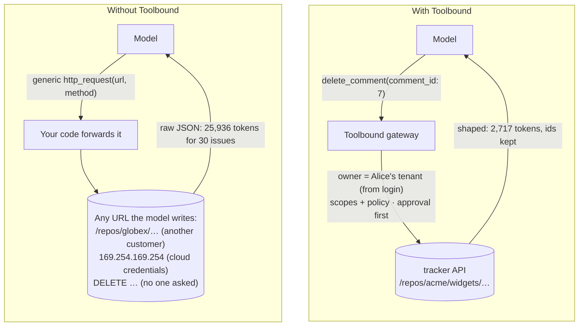
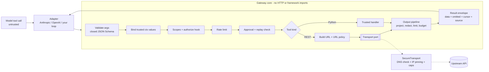

# Toolbound

**Contract-first, secure-by-default tools for AI agents.** Describe each REST endpoint, or
trusted Python function, your agent may use *once*. Toolbound turns it into a narrow,
well-typed tool. It validates every model call, enforces **your** authorization policy and
network rules, asks a human before destructive actions, and shapes the response into
small, bounded, honest output before it reaches the model.


1. The user signs in to **your app**, which builds a trusted `ExecutionContext` (who, which
   tenant, which permissions).
2. Your agent loop shows the model only the tools this user may use.
3. The model asks for a tool with arguments. Your app passes the call to
   `gateway.call(name, args, ctx=ctx)`.
4. Toolbound checks it (schema, trusted values, scopes, your policy, rate limit, replay) and
   sends only a checked request to an allowlisted API, or runs your Python function.
5. The response is cut down to the fields you allowed, within a token budget, and returned
   with a note of what was left out.
6. Destructive calls stop at `approval_required`. Nothing runs until a human approves the
   exact call.

> **Status: alpha (0.2.0, unreleased).** 0.2 is a security-hardening release of 0.1; see the
> [changelog](https://github.com/SaeedNoshadi89/toolbound/blob/main/CHANGELOG.md). The public API
> may still change before 1.0. Not yet published to PyPI.

---

## Contents

- [Why we built this](#why-we-built-this)
- [What it is, and what it is not](#what-it-is-and-what-it-is-not)
- [Install](#install)
- [Quickstart](#quickstart)
- [A complete example](#a-complete-example)
- [Security model](#security-model)
- [Customizing input and output](#customizing-input-and-output)
- [Agent and web integrations](#agent-and-web-integrations)
- [Architecture](#architecture)
- [Benchmarks](#benchmarks)
- [Development](#development)
- [Roadmap and versioning](#roadmap-and-versioning)

## Why we built this

Agents become useful when they can call real APIs. The quickest way to get there is a
generic `http_request(url, method, headers, body)` tool, or a thin wrapper around each
endpoint where the model fills in the URL and ids. That works in a demo and fails in
production. The model now decides *which customer's data* it touches, *which host* it
calls, and *whether* to delete something. A prompt injection hidden in one API response is
enough to steer it.

**A real example from this repository.** [`examples/fastapi_app.py`](https://github.com/SaeedNoshadi89/toolbound/blob/main/examples/fastapi_app.py)
and [`examples/langgraph_agent.py`](https://github.com/SaeedNoshadi89/toolbound/blob/main/examples/langgraph_agent.py)
are a support agent for an issue tracker. One deployment serves many customer
organizations. It has two tools: `list_issues` and `delete_comment` (for removing spam).
Alice works for `acme`, and Bob works for `globex` with read-only access.



| In the example | Generic HTTP tool | Toolbound | Verified by |
|---|---|---|---|
| Whose data? | The model writes `/repos/globex/…` | The owner comes from Alice's login. Passing it as an argument fails with `invalid_arguments` | `tests/integrations/test_fastapi.py::test_tenant_comes_from_auth_not_body` |
| Internal hosts, cloud metadata | Reachable if the model asks | Only allowlisted hosts. Every DNS answer is checked and the connection is pinned to it | `tests/security/test_ssrf.py`, `test_hardening.py` |
| Deleting a comment | Runs immediately | Bob does not even see the tool. Alice's call waits for *her* decision on a channel the agent cannot use, runs once, and cannot be replayed, approved by Bob, or revived after a "no" | `test_fastapi.py::test_human_approval_runs_exactly_once`, `::test_agent_cannot_approve_its_own_request`, `::test_other_user_cannot_see_or_approve` |
| A timeout on the delete | Model sees "retry" and may delete twice | `outcome_unknown`, not retryable. The same tool-call id never runs twice | `tests/security/test_unsafe_retries.py` |
| Response size | 25,936 tokens for 30 issues | 2,717 tokens with the fields you chose and the ids kept | [`benchmarks/`](https://github.com/SaeedNoshadi89/toolbound/blob/main/docs/benchmarks.md) |
| Credentials, cookies | The model or the prompt may see them | Contracts hold only credential names. Echoed secrets are scrubbed, and upstream cookies are never stored or shared between users | `test_credentials.py`, `test_isolation.py::test_c1_*` |

Toolbound does not make the model trustworthy. It makes the *tool layer* enforce your rules
whatever the model asks for, and it returns less untrusted text for the model to be
steered by.

## What it is, and what it is not

| | |
|---|---|
| **A Python library (SDK)** | Yes. It runs inside your application process. `pip install` and import it. |
| **A contract format** | Yes. A versioned YAML/JSON format for approved operations ([reference](https://github.com/SaeedNoshadi89/toolbound/blob/main/docs/contracts.md)), reviewable like code. |
| **A hosted gateway service** | No. Nothing to deploy. |
| **An MCP server** | Not yet. A recipe is in the [integrations guide](https://github.com/SaeedNoshadi89/toolbound/blob/main/docs/integrations.md); a packaged adapter is planned. |
| **Provider adapters** | Small optional adapters for the Anthropic and OpenAI tool formats. They import no provider SDK and contain no security logic. |
| **An agent framework** | No. Toolbound is the *tool layer*. Use it with your own loop, the Anthropic/OpenAI SDKs, LangGraph, FastAPI, or anything else. |
| **A sandbox for Python code** | No. Python tools are **trusted developer code** and run with your application's privileges. |
| **A fact checker** | No. Schema validation proves *shape*, not *truth*. |

**Deliberate non-goals:** agent loops and planning, summarizing upstream data, verifying
that data is true, sandboxing Python, running as a hosted service, GraphQL/gRPC/streaming
responses (for now), and activating OpenAPI specs automatically.

## Install

Requires Python **3.11–3.15**. Runtime dependencies: `httpx`, `jsonschema` and
`cryptography`.

Until the first PyPI release, install from GitHub:

```bash
pip install "toolbound[yaml] @ git+https://github.com/SaeedNoshadi89/toolbound"
# or
uv add "toolbound[yaml] @ git+https://github.com/SaeedNoshadi89/toolbound"
```

Optional extras: `yaml` (YAML contracts), `tiktoken` (tokenizer-based budgets).

## Quickstart

One safe, shaped tool over the public GitHub API (no token needed). This is
[`examples/quickstart.py`](https://github.com/SaeedNoshadi89/toolbound/blob/main/examples/quickstart.py):

```python
import asyncio

from toolbound import ExecutionContext, Gateway, Operation, Output, Service, allow_all, from_ctx

github = Service(
    name="github",
    base_url="https://api.github.com",
    headers={"Accept": "application/vnd.github+json"},
)

get_issue = Operation(
    name="get_issue",
    description="Get one issue from the current repository by number.",
    service=github,
    path="/repos/{owner}/{repo}/issues/{issue_number}",
    input={"issue_number": {"type": "integer", "minimum": 1}},  # all the model can set
    bind={"owner": from_ctx("attributes.owner"), "repo": from_ctx("attributes.repo")},
    output=Output(
        shape={
            "number": "number",
            "title": "title",
            "state": "state",
            "author": "user.login",
            "labels": "labels[].name",
        },
        required=("number", "title"),
        max_tokens=300,
    ),
)


async def main() -> None:
    ctx = ExecutionContext(actor="demo-user", attributes={"owner": "python", "repo": "cpython"})
    async with Gateway(authorize=allow_all).register(get_issue) as gateway:
        print(gateway.definitions(ctx)[0].input_schema)  # what the model sees

        ok = await gateway.call("get_issue", {"issue_number": 1}, ctx=ctx)
        print(ok.to_json())  # {"ok":true,"data":{"number":1,"title":...},"meta":{...}}

        blocked = await gateway.call(
            "get_issue", {"issue_number": 1, "url": "http://169.254.169.254/"}, ctx=ctx
        )
        print(blocked.to_json())  # {"ok":false,"error":{"code":"invalid_arguments",...}}


if __name__ == "__main__":
    asyncio.run(main())
```

What the model sees is only:

```json
{"type":"object","properties":{"issue_number":{"type":"integer","minimum":1}},
 "required":["issue_number"],"additionalProperties":false}
```

## A complete example

Two unrelated services, with credentials, tenant binding, a policy, output shaping, a
blocked request, and a destructive action that needs approval. Contracts can live in YAML…

```yaml
# contracts/crm.yaml
version: 1
service:
  name: crm
  base_url: https://crm.example.com/api
  auth: {type: bearer, credential: crm_token}     # a credential NAME, never the value
  network: {allow_hosts: [crm.example.com]}
  limits: {timeout: 10, max_response_bytes: 2000000}
operations:
  - name: search_customers
    description: Search customers of the current account by name or email.
    path: /tenants/{tenant_id}/customers
    input:
      query: {type: string, minLength: 2, maxLength: 80}
      limit: {type: integer, minimum: 1, maximum: 50, default: 10}
    bind:
      tenant_id: ctx.tenant                       # from trusted context, invisible to the model
    required_scopes: [crm:read]
    output:
      root: data
      shape:
        id: id
        name: full_name
        email: contact.email
        plan: subscription.plan.name
        open_tickets: {from: tickets, transform: count}
      required: [id]
      max_items: 20
      max_tokens: 800
      continuation: true
  - name: delete_customer
    description: Permanently delete a customer record.
    method: DELETE
    path: /tenants/{tenant_id}/customers/{customer_id}
    effect: destructive                           # approval required
    input:
      customer_id: {type: string, pattern: "^cus_[A-Za-z0-9]{8,32}$"}
    bind: {tenant_id: ctx.tenant}
    required_scopes: [crm:admin]
    idempotency_header: Idempotency-Key
```

…or in Python. Both produce the same objects:

```python
import asyncio
from toolbound import (
    Decision,
    EnvCredentials,
    ExecutionContext,
    Gateway,
    Operation,
    Output,
    Service,
    from_ctx,
)


def policy(request):  # your business rules, in trusted code
    if request.tool.effect == "destructive" and request.ctx.attributes.get("plan") != "admin":
        return Decision.deny("only account admins can delete records")
    return True


weather = Service(name="weather", base_url="https://api.open-meteo.com")
forecast = Operation(
    name="current_weather",
    description="Current temperature for a coordinate.",
    service=weather,
    path="/v1/forecast",
    input={
        "latitude": {"type": "number", "minimum": -90, "maximum": 90},
        "longitude": {"type": "number", "minimum": -180, "maximum": 180},
        "current": {"const": "temperature_2m", "default": "temperature_2m"},
    },
    output=Output(root="current", shape={"temperature_c": "temperature_2m", "time": "time"}),
)


async def main():
    gateway = Gateway(
        authorize=policy,
        credentials=EnvCredentials({"crm_token": "CRM_API_TOKEN"}),
        secret=b"load-a-32-byte-or-longer-secret-from-your-vault!!",  # cursors + approvals
    )
    gateway.load("contracts/").register(forecast)

    ctx = ExecutionContext(
        actor="user_123",
        tenant="acme",  # set by YOUR auth layer
        scopes=frozenset({"crm:read", "crm:admin"}),
        attributes={"plan": "admin"},
    )

    result = await gateway.call("search_customers", {"query": "ada"}, ctx=ctx)
    print(result.data, result.meta.to_dict())  # shaped data + what was omitted and why

    forged = await gateway.call(
        "search_customers", {"query": "ada", "tenant_id": "globex"}, ctx=ctx
    )
    print(forged.error.code)  # invalid_arguments: tenant is not an input

    pending = await gateway.call(
        "delete_customer", {"customer_id": "cus_12345678"}, ctx=ctx, call_id="toolu_01"
    )
    print(pending.error.code)  # approval_required (nothing sent yet)
    # ... show pending.approval (target, arguments, summary) to a human; if they approve:
    done = await gateway.resume(
        pending.approval, ctx=ctx, approved_by="user_123", call_id="toolu_01"
    )
    print(done.ok)


asyncio.run(main())
```

More runnable examples, all offline except where noted:

| Example | Shows |
|---|---|
| [`fastapi_app.py`](https://github.com/SaeedNoshadi89/toolbound/blob/main/examples/fastapi_app.py) | per-request context from auth, tool API, approvals across two HTTP requests, user isolation |
| [`langgraph_agent.py`](https://github.com/SaeedNoshadi89/toolbound/blob/main/examples/langgraph_agent.py) | LangGraph graph with approvals through `interrupt()`, safe node re-runs |
| [`quickstart.py`](https://github.com/SaeedNoshadi89/toolbound/blob/main/examples/quickstart.py) | public API, bound parameters, shaping, a blocked argument (network) |
| [`two_services.py`](https://github.com/SaeedNoshadi89/toolbound/blob/main/examples/two_services.py) | two unrelated APIs from YAML, grouped tools, `Link` pagination (network) |
| [`blocked_requests.py`](https://github.com/SaeedNoshadi89/toolbound/blob/main/examples/blocked_requests.py) | forged tenant, injected URL, type confusion, redirect to cloud metadata, untrusted private address |
| [`approval_flow.py`](https://github.com/SaeedNoshadi89/toolbound/blob/main/examples/approval_flow.py) | approval, single-use grants, replay and argument-swap rejection |
| [`custom_python_tool.py`](https://github.com/SaeedNoshadi89/toolbound/blob/main/examples/custom_python_tool.py) | `@gateway.tool`, business policy, budgets, continuation |
| [`pagination.py`](https://github.com/SaeedNoshadi89/toolbound/blob/main/examples/pagination.py) | upstream pagination + token budgets, no items lost, tampered cursor |
| [`legal_retrieval.py`](https://github.com/SaeedNoshadi89/toolbound/blob/main/examples/legal_retrieval.py) | Persian text, required citation fields, `overflow="reject"` |
| [`claude_agent.py`](https://github.com/SaeedNoshadi89/toolbound/blob/main/examples/claude_agent.py) | full Claude agent loop with approvals (calls the paid API) |

## Security model

Toolbound treats **everything the model produces** (tool choice, arguments, cursors) and
**everything upstream APIs return** as untrusted. Trusted inputs are your contracts, your
code, and the `ExecutionContext` your application builds after authenticating the user.

| Layer | Enforced by Toolbound | Not guaranteed |
|---|---|---|
| Structural validation | arguments match a closed schema; unknown arguments fail | permission, truth |
| Authorization | scopes and your `authorize()` hook run before anything executes | the correctness of your policy |
| Effects and approval | `DELETE` is destructive and `POST`/`PUT`/`PATCH` are writes unless declared otherwise. Destructive calls need a human approval tied to the exact actor, tenant, tool, arguments and trusted values, usable once | that the approved action is wise |
| Replay and retries | a tool-call id runs a write at most once; only declared reads (or calls with an idempotency key) are retried automatically; if any attempt of a write may have reached the upstream, the result is `outcome_unknown`, not "retryable" | exactly-once delivery across a crash or a non-shared `StateStore` |
| Network | allowlisted hosts and ports, HTTPS by default, every DNS answer checked and the connection pinned to it, redirects re-checked, credentials dropped across origins, no cookie jar, no proxy variables | network paths outside your process |
| Output | allowlisted fields, redaction (in linear time), limits and budgets, with every omission reported | that redaction catches every secret or fragment of one |

**What it cannot do.** It cannot stop prompt injection from *influencing* the model; it
limits what an influenced model can do. It cannot sandbox Python tools. Replay protection
is per process unless you provide a shared `StateStore`. Please read the
**[threat model](https://github.com/SaeedNoshadi89/toolbound/blob/main/docs/security/threat-model.md)**
and the [security guide](https://github.com/SaeedNoshadi89/toolbound/blob/main/docs/security.md)
before deploying. Report vulnerabilities privately:
**[SECURITY.md](https://github.com/SaeedNoshadi89/toolbound/blob/main/SECURITY.md)**.

**Production checklist:** set a persistent `Gateway(secret=...)` from your secret manager;
use a shared `StateStore` (for example Redis) with more than one worker; run behind an
egress firewall; give each user their own upstream credentials where possible; set
`effect` honestly on every Python tool; prefer explicit `shape`s over pass-through.

## Customizing input and output

**Input** is JSON Schema (draft 2020-12) with nested objects, arrays, enums, bounds,
patterns and defaults. Shorthand `{"name": {...}}` makes every property without a
`default` required. Arguments are placed into path, query or body automatically, or
explicitly with `query=`/`body=`. `bind=` injects trusted values. Path values are strictly
encoded, and `/`, `..` and encoded separators are rejected. `format` keywords are only
enforced when jsonschema's optional format packages are installed (Toolbound warns when
they are not), so use `pattern`/`enum` for security-relevant constraints.

**Output** is a pipeline you control per tool:

```python
Output(
    root="items",  # select part of the response
    shape={  # allowlist + rename
        "id": "id",
        "author": "user.login",  # nested path
        "labels": Field("labels[].name", max_items=5),
        "body": Field("body", max_chars=500),
        "state": Field("state", transform="upper", default="unknown"),
        "comments": Field("comments", shape={"by": "user.login", "text": "body"}),
    },
    required=("id",),  # evidence: never dropped; fail rather than lose it
    max_items=50,
    max_chars=4000,
    max_tokens=2000,  # global limits and budget
    overflow="truncate",  # or "reject": never return partial data
    selectable=True,  # model may ask for a subset of fields (enum, not paths)
    continuation=True,  # encrypted cursor to resume trimmed lists
    redactors=(mask_emails,),  # your PII hooks, after key + secret-pattern redaction
    schema={...},
    schema_mode="strict",  # upstream response contract
    error_shape={"message": "message"},  # short, useful upstream errors
)
```

Reference: [contracts](https://github.com/SaeedNoshadi89/toolbound/blob/main/docs/contracts.md)
(every field, YAML and Python) and
[output](https://github.com/SaeedNoshadi89/toolbound/blob/main/docs/output.md) (pipeline
order, budgets, truncation vs rejection, pagination).

## Agent and web integrations

```python
from toolbound.adapters import anthropic as tb

tools = tb.tools(gateway, ctx)  # filtered for this user
response = client.messages.create(
    model="claude-opus-5-5", max_tokens=16000, tools=tools, messages=messages
)
batch = await tb.run_tool_calls(gateway, response, ctx)
messages += [{"role": "assistant", "content": response.content}, batch.message]
for pending in batch.pending_approvals:
    ...  # show pending to a human; later: await gateway.resume(pending.token, ...)
```

- **Anthropic / OpenAI**: `toolbound.adapters.anthropic` and `toolbound.adapters.openai`
  (Chat Completions and Responses).
- **FastAPI**: [`examples/fastapi_app.py`](https://github.com/SaeedNoshadi89/toolbound/blob/main/examples/fastapi_app.py),
  tested in `tests/integrations/test_fastapi.py`. It creates the gateway in `lifespan`,
  builds the context from authentication, keeps approval tokens server-side, and takes the
  human's decision on a separate channel (session + CSRF) that the agent cannot use.
- **LangGraph**: [`examples/langgraph_agent.py`](https://github.com/SaeedNoshadi89/toolbound/blob/main/examples/langgraph_agent.py),
  tested in `tests/integrations/test_langgraph.py`. It passes the context through
  `context=`, sends tool-call ids as `call_id`, and handles approvals through
  `interrupt()`.
- **MCP, Claude Agent SDK, plain loops**: recipes in the
  [integrations guide](https://github.com/SaeedNoshadi89/toolbound/blob/main/docs/integrations.md).

**Extending:** every outside dependency is a small `typing.Protocol` you can replace:
`Transport`, `CredentialProvider`, `authorize`, `approver`, `TokenEstimator`, `Observer`,
`StateStore`. See the [API reference](https://github.com/SaeedNoshadi89/toolbound/blob/main/docs/api.md).

## Architecture



The design is **lightweight hexagonal**: the core depends only on ports it defines,
adapters plug in from outside, and a CI test fails if the core imports an HTTP client or AI
framework. See the [ADR](https://github.com/SaeedNoshadi89/toolbound/blob/main/docs/adr/0001-architecture.md)
and the [architecture notes](https://github.com/SaeedNoshadi89/toolbound/blob/main/docs/architecture.md).

## Benchmarks

Measured locally with `benchmarks/run.py` (Apple M4 Pro, CPython 3.13.15, tiktoken 0.14.0
`o200k_base` for token counts, 2026-11-10). Fixtures are **synthetic** data shaped like
real APIs. No model was called. Method and caveats:
[benchmarks](https://github.com/SaeedNoshadi89/toolbound/blob/main/docs/benchmarks.md).

| Case | Raw tokens | Shaped tokens | Items | Required fields kept |
|---|---:|---:|---:|:---:|
| GitHub-shaped issue list (30 items) | 25,936 | 2,717 (−90%) | 30/30 | yes |
| same, 1,500-token budget | 25,936 | 894 (−97%) | 10/30 + cursor | yes |
| Persian legal search (20 rulings) | 23,587 | 4,910 (−79%) | 20/20 | yes |

The baseline is the raw upstream JSON, which is what a generic HTTP tool returns. A
hand-written minimal tool would also be small; Toolbound's point is that the small,
checked version is the default. Median added latency against a local HTTP server:
**0.578 ms** per call (0.86 ms in 0.1). A deliberately oversized 4.8 MB result is rejected
in **0.118 s**, off the event loop (it was 8 s, on the event loop, in 0.1).

## Development

```bash
git clone https://github.com/SaeedNoshadi89/toolbound && cd toolbound
uv sync                        # creates .venv with dev tools
uv run pytest                  # everything: unit, security, integration, examples
uv run pytest -m security      # the security regression suite only
uv run ruff check . && uv run ruff format --check . && uv run mypy
TOOLBOUND_NETWORK_TESTS=1 uv run pytest   # also hits api.github.com / open-meteo
uv run --with tiktoken python benchmarks/run.py
```

CI runs lint, strict typing, tests on Python 3.11–3.15 (Linux, macOS, Windows), the
security regression suite as its own job, a dependency vulnerability audit, a workflow
audit, CodeQL, and a wheel build with a clean-install smoke test. A single `required
checks` job fails if any of them fails. See
[CONTRIBUTING.md](https://github.com/SaeedNoshadi89/toolbound/blob/main/CONTRIBUTING.md).

More docs: [API reference](https://github.com/SaeedNoshadi89/toolbound/blob/main/docs/api.md) ·
[FAQ](https://github.com/SaeedNoshadi89/toolbound/blob/main/docs/faq.md) ·
[Release process](https://github.com/SaeedNoshadi89/toolbound/blob/main/docs/releasing.md) ·
[Changelog](https://github.com/SaeedNoshadi89/toolbound/blob/main/CHANGELOG.md).

## Roadmap and versioning

| Version | Planned |
|---|---|
| 0.1 | core pipeline, contracts, secure transport, output shaping, approvals, Anthropic/OpenAI adapters |
| **0.2** (this) | security hardening: no cookie sharing, method-derived effects, encrypted approval requests and cursors, `outcome_unknown`, fail-closed replay store, bounded trimming, FastAPI/LangGraph examples, security regression suite and threat model |
| 0.3 | MCP server adapter, Redis `StateStore`, tool search for large catalogs, OpenTelemetry extra |
| later | OpenAPI → reviewed draft contracts, OAuth helpers, multipart uploads |

Toolbound follows [Semantic Versioning](https://semver.org/). Before 1.0, minor releases
may contain breaking changes, always listed in the changelog. The contract file format is
versioned separately (`version: 1`).

## License

[Apache-2.0](https://github.com/SaeedNoshadi89/toolbound/blob/main/LICENSE): permissive,
with an explicit patent grant. This is not legal advice.
