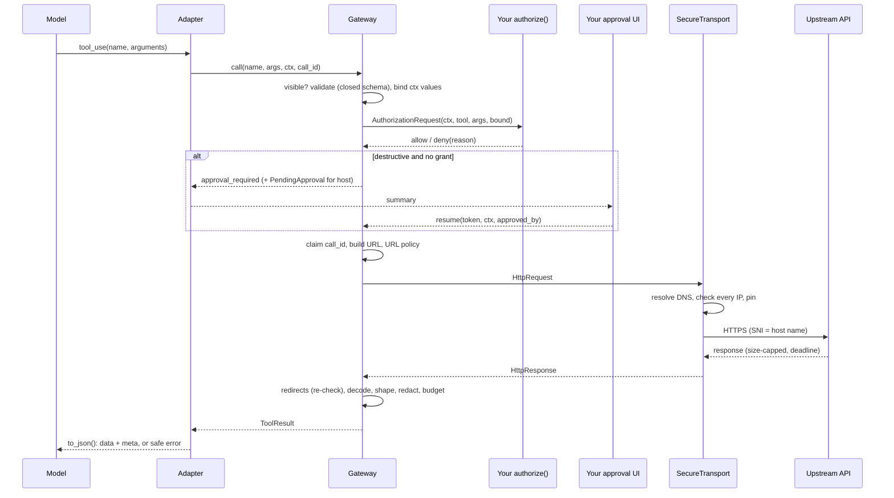

# Architecture

The decision record with alternatives is [ADR 0001](adr/0001-architecture.md). This page
explains how the code is organized and why.

## Layers

```text
src/toolbound/
  core/            the hexagon: no HTTP client, no AI framework, no YAML imports
    contracts.py   Service, Operation, PythonTool, Output, Field, policies, bindings
    schema.py      input schema normalization + validation (structural only)
    network.py     URL construction, URL policy, IP policy (pure, no I/O)
    paths.py       the safe path language
    shaping.py     output pipeline: project, redact, limit, budget
    budget.py      ByteEstimator, canonical JSON
    approval.py    encrypted approval requests, grants bound to the exact call
    signing.py     HMAC-signed tokens (grants) and AES-GCM sealed tokens (cursors,
                   approval requests), with per-purpose derived keys
    ratelimit.py   per-process, thread-safe sliding windows (idle callers forgotten)
    pyschema.py    JSON Schema from Python type hints
    exposure.py    ToolDefinition, grouped strategy
    gateway.py     the pipeline that ties everything together
    ports.py       Transport, CredentialProvider, Authorizer, Approver, TokenEstimator,
                   Observer, StateStore
    credentials.py / state.py / observe.py / result.py / context.py / errors.py
  transport/       outbound adapters: SecureTransport (httpx), MockTransport
  adapters/        inbound adapters: anthropic.py, openai.py (no provider SDK imports)
  loaders/         YAML/JSON contract files + published meta-schema
  estimators.py    optional tiktoken estimator
  sync.py          blocking wrapper
  cli.py           validate / preview contracts
```

**Dependency rule:** `core` imports only the standard library, `jsonschema`,
`cryptography` (AES-GCM for sealed tokens), and other `core` modules. Two lazy, function-level imports wire defaults (`SecureTransport` when no
transport is given, and the loader for `Gateway.load`). `tests/test_architecture.py`
enforces this, and also imports the core with `httpx` blocked.

## Why "lightweight" hexagonal

The useful part of ports-and-adapters here is that **security logic lives in one place**
and every integration (Anthropic, OpenAI, MCP, tests) gets it unchanged. Outside
dependencies are swappable without touching that logic. We stop there:

- no separate domain / application / infrastructure packages: the core is one cohesive
  package of small modules;
- no dependency-injection container: the `Gateway` constructor *is* the composition root;
- ports exist only where a second implementation is real (tests, multi-worker state,
  per-user credentials, other tokenizers, other transports).

## The request path



## Design notes

- **One pipeline.** `PythonTool` and `Operation` differ only in the execute step. That
  is what guarantees custom tools get the same authorization, approval and budgets.
- **Errors are values.** `Gateway.call` returns failures as `ToolResult(ok=False)` with a
  stable `ErrorCode`, because an agent loop must hand *something* back to the model.
  Configuration mistakes raise at registration, so they surface at startup.
- **Deterministic output.** Parameters are emitted in schema order, JSON is serialized
  compactly, and budget trimming has a fixed order. The same input always gives the same
  bytes, which helps tests, caching and prompt-cache stability.
- **Redirects in the core, IP checks in the transport.** Redirect handling needs policy
  (allowlists, credential stripping), so it is core logic. Only the transport knows the
  address it actually connects to, so IP checks live there, using the core's pure
  `check_ip`.
- **Signed state instead of server state.** Cursors and grants are self-contained HMAC
  tokens, so the gateway needs no session storage. Only single-use enforcement needs the
  `StateStore`.

## Concurrency and deployment model

- **Event loops.** A `Gateway` may be used from several event loops (for example FastAPI
  test clients, or `SyncGateway` in worker threads). Objects bound to a loop
  (`httpx.AsyncClient`s in `SecureTransport`, per-service `asyncio.Semaphore`s) are created
  per loop and released when the loop is garbage-collected.
- **Threads.** `MemoryStateStore` and `RateLimiter` use `threading.Lock`, not asyncio locks:
  their critical sections never await.
- **CPU-heavy work.** Decoding and shaping bodies over 256 KB run in `asyncio.to_thread`, and
  budget trimming has a fixed work cap, so a hostile response cannot stall the loop.
- **Processes and workers.** Cursors and approval tokens are stateless (sealed with the
  gateway secret), so they work on any worker that shares the secret. Single-use claims
  (approvals, call ids) need a shared `StateStore`. Rate limits are per process.
- **At-most-once writes.** A call id is claimed *before* execution. This trades
  retry-ability for safety: a failed write is never repeated with the same id. Uncertain
  outcomes are reported as `outcome_unknown`.

Threats and assumptions behind these choices: [threat model](security/threat-model.md).
