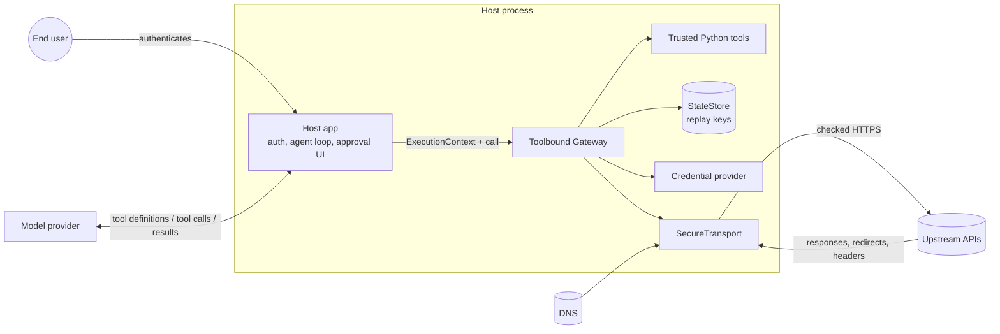

# Threat model

Version: Toolbound 0.2.0 · Last reviewed: 2026-11-10 (after two independent reviews) · Method: data-flow diagram + STRIDE
per element, with explicit assumptions and residual risks.

This document is for people deploying Toolbound and for security reviewers. It separates
**guarantees** (enforced by Toolbound's code and covered by the security regression suite)
from **limitations** (things Toolbound cannot or does not do). The control-by-control
reference with test names is in [the security guide](../security.md).

## 1. System overview

Toolbound is a library inside the host application's process. A model proposes tool
calls; the host passes them to `Gateway.call(name, arguments, ctx=...)`; Toolbound decides
whether and how they run against allowlisted HTTP APIs or trusted Python functions, and
returns a bounded result.

### Trust boundaries

| # | Boundary | Crosses it | Treated as |
|---|---|---|---|
| TB1 | Model → host → Gateway | tool name, arguments, cursors | **untrusted** |
| TB2 | Upstream → transport → Gateway | status, headers, body, redirects, `Link`, cookies, errors | **untrusted** |
| TB3 | DNS → transport | address records | **untrusted** (checked and pinned) |
| TB4 | Host app → Gateway | `ExecutionContext`, contracts, policy hooks, approvals | **trusted** (the host's responsibility) |
| TB5 | Approval UI / browser / workflow store → host | approval request tokens, decisions | **untrusted data** carrying gateway-signed tokens |
| TB6 | Worker ↔ worker | `StateStore`, signing secret | trusted infrastructure |

## 2. Assets

| Asset | Why it matters |
|---|---|
| A1 Upstream credentials (API keys, OAuth tokens) | full access to third-party systems |
| A2 Tenant / user data in upstream systems | confidentiality and integrity across customers |
| A3 Internal network and cloud metadata endpoints | lateral movement and credential theft |
| A4 Integrity of write and destructive operations | money moved, records deleted, messages sent |
| A5 Human approval decisions | the last control before irreversible actions |
| A6 Gateway signing secret | forging cursors or approval grants |
| A7 Host availability (event loop, memory, upstream quotas) | one bad call must not take the app down |
| A8 Model context (what the model reads) | prompt-injection surface and token cost |

## 3. Attackers and capabilities

| Attacker | Capabilities assumed |
|---|---|
| **M: Manipulated model.** The model follows instructions planted in user input, documents, or upstream data (prompt injection) | chooses any visible tool and any schema-valid arguments; echoes or mutates cursors; repeats calls; calls tools in parallel |
| **U: Malicious or compromised upstream API** | returns arbitrary bodies, sizes, encodings, headers, redirects, `Link` headers, `Set-Cookie`, slow or partial responses, and text designed to inject the model |
| **D: DNS attacker** | returns different answers over time (rebinding), private or mixed answers |
| **T: Malicious tenant / user of the host app** | controls their own conversation and approvals; may try to reach other tenants' data, replay or steal approval tokens, or exhaust shared resources |
| **N: Network observer** outside TLS | cannot read or modify TLS traffic; may see plain HTTP if a contract allows it |

Not in scope: an attacker who controls the host process, the host's authentication, the
`ExecutionContext`, the contracts, Python tool code, the `StateStore`, or the signing
secret. Those are the host's trusted computing base.

## 4. Assumptions

1. The host authenticates users and builds the `ExecutionContext` from that
   authentication, never from model output or request bodies.
2. Contracts and Python tools are reviewed like code. `status: draft` imports are not
   loaded until activated.
3. `effect` is set honestly. `DELETE` is inferred as destructive and `POST`/`PUT`/`PATCH` as
   writes, but a Python tool's effect can only be what its author declares.
4. Production deployments set `Gateway(secret=...)` from a secret manager. With more than
   one worker or process, they use a **shared, durable** `StateStore`.
5. The host's `authorize()` hook implements business rules that scopes cannot express.
6. Clocks are roughly synchronized (token expiry uses wall-clock time).

## 5. STRIDE analysis

Each threat has an id, the attacker, the controls, and its status: **G** means guaranteed
by Toolbound and covered by `tests/security`; **S** means shared, depending on host
configuration stated in the assumptions; **R** means residual (not mitigated by
Toolbound).

### Spoofing

| Id | Threat | By | Controls | Status |
|---|---|---|---|:---:|
| S1 | Model claims to be another user or tenant (e.g. passes `tenant_id`) | M | identity only from `ExecutionContext`; bound parameters are not in the schema; unknown arguments rejected | G |
| S2 | Model approves its own action | M | grants are passed by host code as a keyword argument, never as tool arguments; reserved names cannot be inputs | G |
| S3 | Another user replays or steals an approval token | T | approval requests are encrypted and authenticated (AES-256-GCM); the grant digest binds actor, tenant, tool, contract fingerprint, arguments and trusted values; a different context fails | G |
| S4 | Forged approval request built by the host from client data | T | `grant()`/`resume()` trust only the gateway-issued token, never `PendingApproval` fields | G |
| S5 | DNS rebinding to impersonate an allowed host | D | every answer checked, connection pinned to the checked address, no second lookup; TLS verifies the original name | G |
| S6 | Token forged with a guessed or leaked secret | — | 32-byte minimum secret; per-purpose derived keys; rotation invalidates all tokens | S (secret management) |

### Tampering

| Id | Threat | By | Controls | Status |
|---|---|---|---|:---:|
| T1 | Path/query injection, traversal, encoded separators | M | strict per-segment encoding, rejection of `/ \ ? #`, dot segments and encoded separators; the built URL must stay under the base URL | G |
| T2 | Cursor tampering or replay to reach other pages, tenants, scopes or URLs | M | encrypted, authenticated cursors bound to tool, contract fingerprint, actor/tenant, arguments **and trusted bound values** (a cursor minted under another org/repo binding is refused); `Link` targets must be same-origin and same-path, and are re-checked | G |
| T3 | Arguments changed between approval and execution | M, T | the digest is recomputed from the live call; any change fails | G |
| T4 | Upstream response alters tools, policy or approvals | U | results are data; definitions, policy and approvals are fixed by trusted code | G |
| T5 | Approval UI shows something different from what runs | M | summaries show method, resolved URL, every argument and trusted values; control and bidi characters are escaped; truncation is flagged | G (display) / S (UI must render it) |
| T6 | Mass assignment through nested objects (`role`, `is_admin`) | M | every nested schema with `properties` is closed, whatever its `type` (`["object","null"]`, untyped, inside `anyOf`); open objects without explicit `additionalProperties` produce a warning | G |
| T7 | The agent approves its own request | M | grants are host-only; the approval token must reach the human through a channel the agent cannot use (see the FastAPI example: session cookie + CSRF, token kept server-side); `gateway.deny()` makes a refusal final | S (host must separate channels) |

### Repudiation

| Id | Threat | By | Controls | Status |
|---|---|---|---|:---:|
| R1 | "I never approved that" | T | grants record `approved_by`; `approval.granted` events carry it | S (host must store events in an audit log) |
| R2 | No trace of what the model attempted | M | structured `Observer` events for every call, denial, block and attempt (no payloads) | S |

### Information disclosure

| Id | Threat | By | Controls | Status |
|---|---|---|---|:---:|
| I1 | SSRF to internal services or cloud metadata | M, U, D | URL policy (scheme, host allowlist, ports, no userinfo, no numeric hosts) and IP policy (private, loopback, link-local, CGNAT, ULA, special-purpose and embedded IPv4 ranges blocked, independent of the Python version) at every hop | G |
| I2 | Credentials leaked to other origins via redirects | U | redirects off by default; when on, `Authorization`, `Cookie` and API-key headers are dropped on origin change, and every hop is re-checked | G |
| I3 | **Upstream cookies shared between users** (found in 0.1, fixed in 0.2) | U, T | the transport never stores cookies | G |
| I4 | Credentials echoed back into the model | U | echoed credentials are scrubbed in raw, URL-encoded (`quote`, `quote_plus`), JSON-escaped and base64 forms, in values **and object keys**; sensitive key names match case- and separator-insensitively (`accessToken`, `x-api-key`); key-based redaction also applies to renamed fields; secret patterns are redacted | G (exact values and those encodings) / R (fragments or other transformations of a secret, and pattern false negatives) |
| I5 | Trusted values or upstream tokens readable inside cursors | M | cursors are encrypted | G |
| I6 | Hidden tools discovered by probing | M | hidden and unknown tools return the same error | G |
| I7 | Over-sharing of upstream data to the model | M, U | allowlist shapes, limits, budgets | S (contract quality) |
| I8 | Secrets in logs | — | events carry no payloads; request and response `repr` hide headers, bodies and query values | G |

### Denial of service

| Id | Threat | By | Controls | Status |
|---|---|---|---|:---:|
| D1 | Huge, compressed or slow responses | U | decompressed size cap, early `Content-Length` rejection, per-attempt deadline, per-call total deadline including retries | G |
| D2 | **Process stalled by output processing** (trimming found in 0.1; quadratic secret-pattern regex found in the second 0.2 review) | U | secret patterns are linear (token patterns start only at run boundaries, possessive bounded quantifiers; private-key blocks found with plain string search); redaction only examines what can still be returned (`max_chars` + 4 KB); bounded trimming work; large decode and shaping run in a worker thread | G |
| D3 | Tool-call floods | M, T | per-tool rate limits (per tenant-qualified actor, tenant or global), per-endpoint concurrency limits (name + base URL), a private thread pool for sync Python tools so stuck handlers cannot starve DNS resolution; rate-limiter memory is bounded by recently active callers | G (per process) / S (shared limits need your infrastructure) |
| D4 | Replay store exhaustion used to evict live keys, or to block other users | M, T | the in-memory store never evicts unexpired keys; keys are partitioned per actor+tenant with a per-partition quota, so one actor filling its quota blocks only itself (non-retryable error); a global cap bounds memory | G (per partition) / R (many colluding actors can still reach the global cap; size it, or use a shared store with its own quotas) |
| D5 | Upstream quota burned by retries | U | bounded retries with jitter, `Retry-After` ceiling, total deadline | G |

### Elevation of privilege

| Id | Threat | By | Controls | Status |
|---|---|---|---|:---:|
| E1 | Calling tools beyond the user's permissions | M | required scopes hide and block tools; `authorize()` runs before every execution, including after approval | G (enforced) / S (policy content) |
| E2 | **Destructive operation mis-declared as read** (found in 0.1, fixed in 0.2) | — | effect inferred from the HTTP method; `DELETE` cannot be `read`; Python tools must declare an effect | G (REST) / S (Python) |
| E3 | **Write executed twice** (duplicate call ids, unsafe retries, unknown outcomes) | M, U | call ids claimed immediately before execution; automatic retries only for declared reads over safe methods, or with an idempotency key; if **any** attempt or redirect hop may have reached the upstream, a failed write is `outcome_unknown` (not retryable), including 3xx answers and blocked or refused later hops; idempotency keys are stable across internal retries | G (per `StateStore`) |
| E4 | Approval bypass through a contract change | — | the contract fingerprint is part of the digest | G |
| E6 | Approval burned or reused by ordering tricks | M | grants are verified first and used up only immediately before execution, after the call-id claim and every check that can fail without side effects | G |
| E7 | Probing hidden tools through a group's `action` | M | hidden actions return the same error as missing ones | G |
| E5 | Python tool does more than declared | — | none: Python tools are trusted code and are **not sandboxed** | R |

## 6. Abuse scenarios

1. **Injected issue comment asks the agent to delete everything.** The model calls
   `delete_comment` in a loop. Every call stops at `approval_required`, and a human sees the
   exact target. Approvals are single-use. With rate limits, a flood is throttled (E1, E3, D3).
2. **Upstream redirects to `169.254.169.254`.** With redirects disabled, the call fails.
   With redirects enabled, the hop is rejected by IP policy before any connection (I1).
3. **Attacker tenant in a shared SaaS deployment** gets the upstream to set a session
   cookie, hoping a later call for another tenant reuses it. No cookie is ever stored (I3).
4. **Stolen approval link.** Bob obtains Alice's approval token from a shared screen. Using
   it under Bob's session fails, because the digest is bound to Alice and her tenant (S3).
5. **Gateway timeout on a payment POST.** The model is told `outcome_unknown` and not to
   retry blindly. The same call id is never executed twice (E3).
6. **4.8 MB adversarial response** designed to make trimming expensive. Work is bounded and
   happens off the event loop (D2).

## 7. Multi-tenant and multi-worker deployments

| Requirement | Why | If ignored |
|---|---|---|
| Build `ExecutionContext` per request from authentication | all isolation keys (actor, tenant, scopes, bound values) come from it | cross-tenant access |
| Bind tenant/resource identifiers with `bind=`, never as model inputs | the model cannot change them | S1 becomes possible |
| Persistent `secret=` shared by all workers | cursors and approval tokens verify on any worker and survive restarts | tokens fail (fail closed) after restarts or on other workers; a warning is emitted |
| Shared durable `StateStore` (Redis `SET NX EX` or a database unique key) | replay and duplicate-call protection across processes | the same approval or call id may execute once **per worker** |
| Per-user upstream credentials where the API supports them | upstream enforces its own isolation as a second layer | the gateway's binding is the only isolation |
| One gateway per process, used from any number of event loops or threads | transport clients and concurrency limits are kept per event loop, and state is thread-safe | — |

## 8. Custom Python tools

Python tools run with the host's full privileges. Toolbound validates their input,
applies scopes, policy, approvals, replay protection, rate limits and timeouts, and shapes
their output. It does **not** limit what the function does: it cannot stop file, network
or database access, and a timed-out synchronous handler keeps running in its thread.
Therefore a timed-out write tool reports `outcome_unknown`. Treat each Python tool as a
privileged API endpoint: declare its `effect` honestly, check resource ownership inside it
or in `authorize()`, and never pass model text into shells, SQL or `eval`.

## 9. Prompt injection

Toolbound assumes the model **will** sometimes follow injected instructions. It cannot
detect or prevent that. It limits the consequences:

- the model can only reach registered, visible tools with schema-valid arguments;
- identity, tenant and targets come from trusted context;
- writes are replay-protected and destructive actions need a human;
- shaped output means less attacker-controlled text reaches the model.

Residual risk: an injected model can still misuse *allowed* tools within *allowed*
arguments (for example reading data the user may read and summarizing it misleadingly).
Mitigate in the application: narrow tools per task, require approval for sensitive
writes, and verify important facts outside the model.

## 10. Untrusted upstream APIs

Upstream responses are untrusted for safety, not only correctness. Toolbound bounds size
and time, refuses unexpected content types, validates shape (optionally strict), keeps
redirects and pagination targets inside policy, ignores cookies, and reports omissions.
It cannot know whether the data is **true**, and it cannot stop an upstream that itself
fetches attacker-chosen URLs (its own SSRF surface).

## 11. Guarantees vs limitations at a glance

**Guaranteed (tested in `tests/security`):** no model-chosen URLs, hosts, headers or
credentials; strict path and query encoding; DNS-pinned, policy-checked connections at
every hop; no cookie sharing; credentials dropped across origins; echoed credentials
scrubbed; encrypted, bound cursors and approval requests; approvals bound to the exact
call and single-use; at-most-once execution per tool-call id per `StateStore`; no
automatic retries of non-idempotent requests; honest `outcome_unknown`; fail-closed replay
store; bounded response size, time and trimming work; hidden tools indistinguishable from
unknown ones.

**Not guaranteed (limitations):** correctness of your policy and contracts; behavior of
Python tools; prevention of prompt injection; truth of upstream data; complete secret
detection by patterns; replay protection across processes without a shared store;
exactly-once delivery (an approved call that times out may or may not have happened; after `outcome_unknown` a new call id gets a new idempotency key);
detection of partial or transformed fragments of credentials;
network paths outside the process (service meshes, proxies, NAT); upstream APIs' own
vulnerabilities.

## 12. Review triggers

Update this document when: a new transport, adapter or state store ships; a vulnerability
is reported; the approval, cursor or retry design changes; or a new class of tool (for
example streaming or file upload) is added. Every new threat with status **G** needs a
test in `tests/security`.
